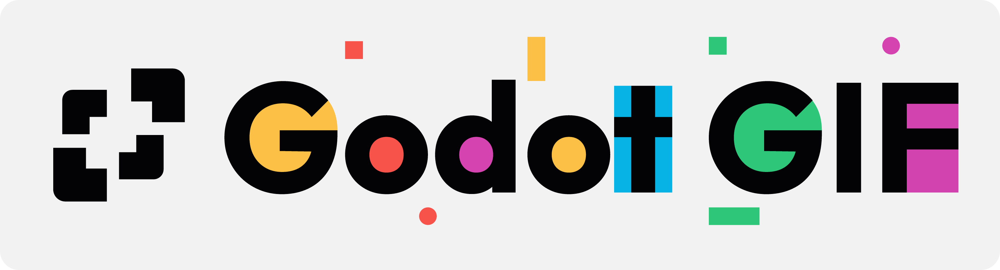

<p align="center">A lightweight GIF reader and writer for Godot 4.</p>

## Overview

Godot-GIF is a GDExtension plugin for Godot Engine 4.x that provides GIF reading and writing capabilities. It wraps giflib 5.2.2 to enable importing, exporting, and playing GIF files in Godot projects.

## Features

- Import GIFs as  `GIFTexture` resources and inspect individual frames in Godot 4.7's native texture preview.
- Play GIF animations with  `GIFPlayer`, with control over speed, looping, and playback mode.
- Read GIF frames and metadata, or write GIFs from `Image` arrays with custom frame delays and transparency.

## Installation

1. Copy or symlink the `addons/godot_gif/` folder into your Godot project's `addons/` directory
2. Restart Godot or enable the plugin in Project Settings

For the Simplified Chinese class reference and `GIFPlayer` Inspector labels, select **Simplified Chinese** in **Editor Settings → Interface → Editor → Localization → Editor Language**, then restart the editor. Set **Interface → Inspector → Default Property Name Style** to **Localized** to show translated property names.

## Quick Start

### Loading a GIF

```gdscript
var gif = GIFTexture.load_from_file("res://animation.gif")
$TextureRect.texture = gif
```

### Playing Animation

```gdscript
$GIFPlayer.gif = GIFTexture.load_from_file("res://animation.gif")
$GIFPlayer.play()
```

### Writing a GIF

```gdscript
var images: Array[Image] = [frame1, frame2, frame3]
var delays: Array[int] = [100, 100, 100]  # milliseconds

GIFWriter.save_to_file("res://output.gif", images, delays)
```

## License

MIT License. See LICENSE.txt for details.

Includes giflib 5.2.2 (MIT License)
